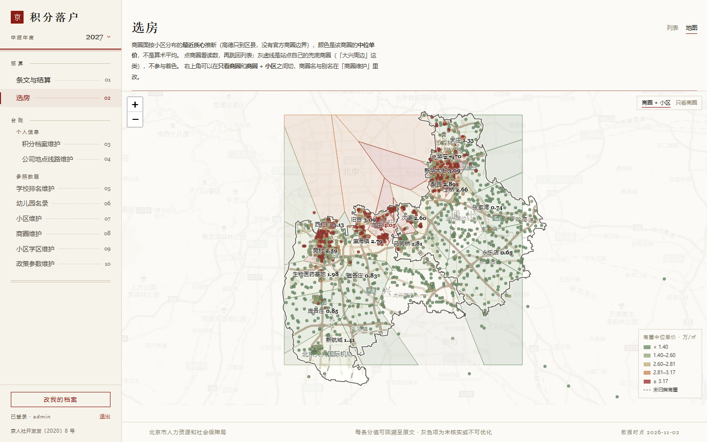
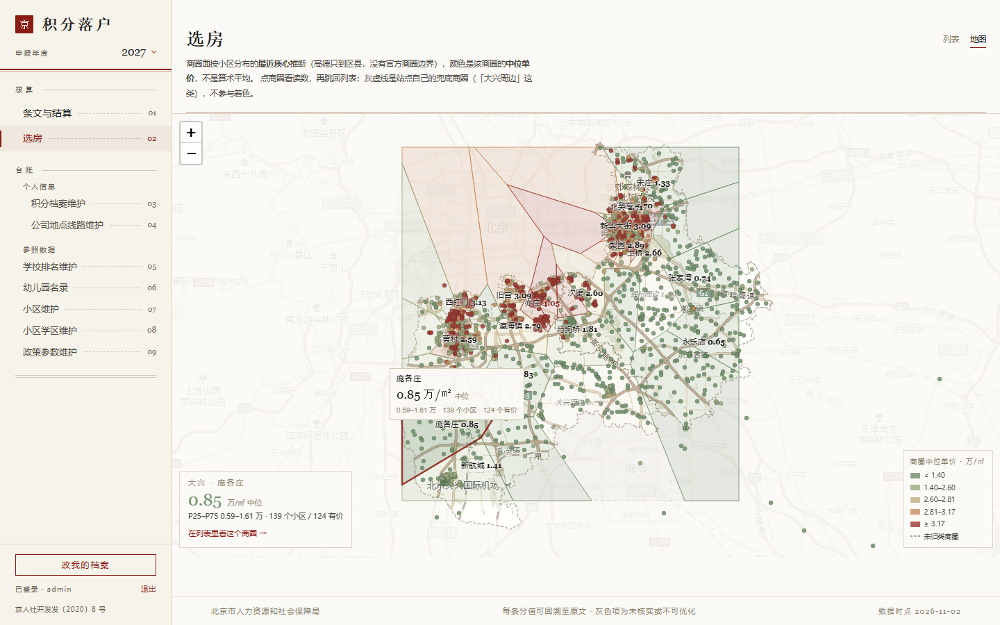

# 地图模式调研：商圈 → 小区 → 单价

> 目标：在现有选房页之外增加一个地图视图，第一层看商圈，点开看商圈里的小区，每层都带单价。
> 本文所有数字均为 2026-11-03 在本机 `data/luohu.db` 与真实浏览器里实测所得，不是估算。

## 0. 结论

**走 Leaflet（前端本地包）+ 后端瓦片代理（`/api/tiles/:z/:x/:y` → 高德栅格瓦片，磁盘缓存）+ 构建期生成商圈面 GeoJSON。**

三个理由，都是实测出来的，不是偏好：

1. 高德官方 JS API 在这台机器上**加载不出来**——`webapi.amap.com` 被公司 Zscaler 307 到 SAML 认证页，`window.AMap` 始终 `undefined`；而瓦片主机的请求由后端发起就正常。
2. 库里坐标是**百度 BD-09**，不是高德 GCJ-02，直接画会整体偏 630 米，必须先转换。
3. 商圈没有官方边界，高德只能给行政区（通州一圈 1833 点、大兴一圈 2051 点），商圈面要自己用小区点造。

已经跑通一张真实数据的 PoC 图（50 个可画面的商圈 + 2404 个小区点 + 真实底图），见 `docs/img/map-poc-z11.png`、`docs/img/map-poc-z13-crop.png`。

---

## 1. 手上已有什么

| 项 | 实测数量 | 说明 |
| --- | --- | --- |
| 小区总数 | 2719 | `community` 表（统计时点 2026-11-03 09:43，库仍在增长） |
| 有经纬度 | 2404 | 88% |
| **有坐标且有价** | **2109** | 地图上真正能出数的点，色阶只对它着色 |
| 有挂牌价 | 2424 | 89% |
| 多源价（≥2 源） | 670 | `community_price` 可交叉验证 |
| 商圈数 | 66 | 通州 40 / 大兴 26，`bizcircle` 字段，**无一为空** |
| **能上地图的商圈** | **50** | 有中心点；另 **16 个全由无坐标小区组成**，画不出面（见 §5④） |
| 商圈中位单价范围 | 6,300 – 49,460 元/㎡ | 6 档色阶够用 |
| 商圈级通勤 | 已有 | `transit_cache` + `precompute()` 按商圈中心算过，**这是地图能打的差异点** |

也就是说：**价格数据一个字节都不用新抓**。真正缺的三样是「商圈面」「坐标转换（BD-09→GCJ-02）」和「315 个缺失坐标的补采」——最后一项里 `通州/万达` 那 31 条最值得补，它是个真实商圈而不是脏数据。

---

## 2. 四个决定性实测

### 2.1 坐标是 BD-09，不是 GCJ-02（必须转，否则整体偏 630 米）

抽样 6 个小区，用高德 POI 同名查询对比：

| source | 名称 | 库内 | 高德 POI | Δlng | Δlat |
| --- | --- | --- | --- | --- | --- |
| multi | 长兴公寓 | 116.xxx | 116.xxx | +0.00654 | +0.00573 |
| multi | 新华小区 | 116.xxx | 116.xxx | +0.00637 | +0.00596 |
| anjuke-mobile | 同华园小区 | 116.xxx | 116.xxx | +0.00657 | +0.00581 |
| 均值 | — | — | — | **+0.00640** | **+0.00584** |
| 标准差 | — | — | — | 0.0001 | 0.0002 |

偏移量高度恒定 = 坐标系差异，不是标注误差。BD-09→GCJ-02 在北京的理论偏移是 (+0.00638, +0.00634)，吻合。

回验「天时名苑」：库值 `116.640227,39.9112` → `bd2gcj()` → `116.633845,39.904871`，高德 POI 是 `116.633990,39.904541`，**误差 15–37 米**（转换前差 630 米）。

结论：所有出图坐标走一遍 `bd2gcj()`。函数（无依赖，直接抄）：

```js
const PI = Math.PI, X_PI = (PI * 3000) / 180;
function bd2gcj(lng, lat) {
  const x = lng - 0.0065, y = lat - 0.006;
  const z = Math.sqrt(x * x + y * y) - 0.00002 * Math.sin(y * X_PI);
  const th = Math.atan2(y, x) - 0.000003 * Math.cos(x * X_PI);
  return [z * Math.cos(th), z * Math.sin(th)];
}
```

> 注意 `bizcenter` 里的中心点是小区坐标的平均值，同样是 BD-09，一起转。

### 2.2 高德 JS API 在这台机器上加载失败（Zscaler 拦）

真实 Chromium 加载 `<script src="https://webapi.amap.com/maps?v=2.0&key=...">`：

```
307 https://webapi.amap.com/maps?v=2.0&key=***
307 https://gateway.zscaler.net/auD?origurl=...
200 https://gateway.zscaler.net/auT?origurl=...
    <!--samlchecks_get.html--> <title>Welcome To Zscaler Directory Authentication</title>
→ script onload 触发，但 window.AMap === "undefined"
```

同一个 URL 用 curl 直连能拿到 968 KB 正常 JS；`restapi.amap.com` 在浏览器里也正常；但由页面 `<script>` / `` 发起的第三方子资源会被 307 到认证网关。

所以：**高德 JS API、以及前端直连高德瓦片，在公司网都跑不起来**。这不是 key 的问题（`.env` 里那把 32 位 Web 服务 key 是有效的，`restapi` 全部 200），是出口策略的问题。

### 2.3 瓦片由后端代理就通了（已验证出图）

后端 `fetch` 抓 `https://webrd0{1-4}.is.autonavi.com/appmaptile?lang=zh_cn&size=1&scale=1&style=8&x={x}&y={y}&z={z}`，落盘缓存，前端只请求 `/api/tiles/{z}/{x}/{y}`：

```
瓦片 缓存命中 0 / 新抓 70 / 失败 0 | 前端异常 none
磁盘占用 1.1 MB（11 级通州+大兴全景 70 张）
```

出图正常：路网、绿地、水系、G102/G1/G3、地铁站名、"北京物资学院通州校区" 等注记都在，商圈标签与小区点落在正确位置（见 PoC 图）。

style 取值：`7` = 纯路网老样式，`8` = 路网 + 注记（推荐）；`webst0{1-4}` + `style=6` 是卫星图，`style=8` 是卫星注记。

### 2.4 商圈没有官方边界，得自己造

- 高德 `DistrictSearch` / `/v3/config/district?extensions=all` 只到行政区：通州 `110112` 一圈 1833 点、大兴 `110115` 一圈 2051 点。**没有商圈层级**。
- 安居客/链家的「商圈」只是列表页的分类标签，站点不对外提供 polygon。
- 所以商圈面只有三条路：

| 做法 | 效果 | 代价 |
| --- | --- | --- |
| **凸包 convex hull**（PoC 用的） | 贴合小区分布，但相邻商圈会重叠，狭长商圈会盖到别人头上 | 20 行代码，无依赖 |
| **Voronoi（泰森多边形）** | 无缝隙无重叠，每个点归属最近的商圈中心，视觉最像竞品 | 需 `d3-delaunay`，Voronoi cell 是凸的但区界是凹的，要与区界求交（可省，直接画到 bbox 也行） |
| 手绘 polygon | 最准 | 66 个商圈人工描边，不划算 |

**推荐 Voronoi**（`d3-delaunay` 约 8 KB，构建期算一次出 GeoJSON），凸包作为一天就能出的过渡版本。

---

## 3. 方案对比

| 方案 | 底图 | 要 Key | 公司网 | 离线 | 包体积 | 工作量 |
| --- | --- | --- | --- | --- | --- | --- |
| **A. Leaflet + 后端瓦片代理** ✅推荐 | 高德栅格 | 否 | 实测可用 | 缓存后可用 | `leaflet@1.9.4` 42 KB gz | 1.5–2 天 |
| B. 高德 JS API 2.0 | 高德矢量 | 需 JS API key + 安全密钥 + 域名白名单 | **实测不可用** | 否 | 1 MB+ | 0.5 天（做不成） |
| C. MapLibre + PMTiles 离线包 | 自建 | 否 | 可用 | 完全离线 | PMTiles 北京 z8–14 约 150–300 MB | 4–6 天 |
| D. Leaflet + OSM 镜像 | OSM | 否 | `tile.openstreetmap.org` 被拦，`a.tile.openstreetmap.fr` 通 | 否 | 42 KB | 1 天（北京地名差、英文注记） |

A 胜出的关键不是"简单"，是**唯一同时满足「公司网能用」+「不需要新 key」+「坐标与高德同源」**的方案。C 留作二期：真要离线或搬到没网的机器，PMTiles 是正解。

---

## 4. 推荐实现

### 4.1 图层

```
L0 底图     高德栅格（CSS filter 灰化，融进现有水墨体系）
L1 区界     区外纸色遮罩（evenodd 挖洞，垫底）+ 通州/大兴边界（纸色底衬 + 墨色实线，压顶）+ 区名大字
L2 商圈面   Voronoi 填充，fill 按中位单价 5 档，opacity ≈ 0.16
L3 商圈标签 divIcon：商圈名 + 「3.08 万」，白描边保证任何底色上可读
L4 小区点   canvas circleMarker r=2.6，同色阶，zoom ≥ 13 才绘
L5 选中态   商圈面描边加重 + 卡片
```

PoC 实测：2404 个坐标点用 `preferCanvas: true` 渲染无压力，不需要 MarkerCluster；其中 2109 个有价、按色阶着色，其余 295 个画成空心灰点。

### 4.2 视觉

现有前端是水墨 + 朱红（`src/index.css` 的 `--color-ink` / `--color-seal`）。底图用 CSS 直接调：

```css
.leaflet-tile { filter: grayscale(.82) contrast(.92) brightness(1.06) sepia(.12); }
```

色阶（已按真实分布分档，覆盖 6,300–49,460）：

| 档 | 中位单价 | 色 |
| --- | --- | --- |
| 1 | < 1.5 万 | `#6f8f6a` 苔绿 |
| 2 | 1.5–2.2 万 | `#9aa87f` |
| 3 | 2.2–3 万 | `#c2ae7f` 麦 |
| 4 | 3–3.8 万 | `#c98b5e` 赭 |
| 5 | ≥ 3.8 万 | `#9d3a32` 朱红 |

朱红给最贵——跟产品里「朱红 = 代价高」的既有语义一致（HouseHunt 的通勤分档就是这么用的）。

### 4.3 交互

- **点商圈面** → 右侧列表按该商圈过滤（复用现有 `/api/communities?district=&bizcircle=`，`HouseHunt` 的 FilterBar 已有这个参数）
- **hover 商圈** → tooltip：中位单价 / 最便宜最贵 / 小区数 / **到各工作地点的通勤区间**（`transit_cache` 现成的，这是链家安居客都给不了的）
- **着色维度切换**：单价 / 通勤 / 建成年，三个都是库里现成字段
- **缩放语义**：z<12 商圈面 + 标签；z 12–14 加小区点；z>14 小区点 + 名称
- 默认视野 `[39.875, 116.62] z11`，正好一屏装下通州 + 大兴

### 4.4 数据管道与接口

构建期生成（推荐，前端零计算）：

```
scripts/gen_map_geojson.mjs   db → data/map.json
  ├─ bd2gcj() 转换所有坐标
  ├─ 商圈聚合：中位价 / low / high / 样本数 / Voronoi 面
  └─ 小区点：id/name/bizcircle/lng/lat/price/tier
```

运行时接口（二选一，建议都要）：

```js
GET /api/map/biz?district=&basis=mid   // 商圈聚合 + 面（GeoJSON FeatureCollection）
GET /api/map/comms?district=&maxPrice= // 小区点（含 transit 挂载）
GET /api/tiles/:z/:x/:y                // 瓦片代理 + 磁盘缓存
```

瓦片代理要点：

```js
// 缓存目录不要写 C 盘，用 data/tiles 或 D:\dsh\cache\tiles
// 上游 307/失败要返回占位透明 PNG，不然 leaflet 会一直重试
// 只允许 z 10–17，挡掉任意 z 的目录穿越与扫量
```

> ⚠️ `vite.config.ts` 里 dev 的 `/api` 默认打线上 `https://luohu.allen1991.cc.cd`，新接口**必须先部署到线上**才能在 `pnpm dev` 里生效；本地调试要用 `pnpm dev:local`（读 `.env.local` 的 `LUOHU_API`）。线上在阿里云，直连 `autonavi` 无阻碍，瓦片代理放线上没问题。

---

## 5. 数据治理（地图的前置条件）

地图会把脏数据放大成肉眼可见的错位，下面这些必须先处理：

**① 兜底商圈画面会被拉偏**

| 商圈 | 小区数 | 有坐标 |
| --- | --- | --- |
| 大兴周边 | 115 | 115 |
| 通州周边 | 62 | 62 |
| 通州其它 | 31 | 0 |
| 大兴其它 | 11 | 0 |

「周边/其它」是站点自己没归类的兜底桶，点会撒在行政区边缘那一圈。处理：只画点、不画面，标签标灰。

> 所以最终画面数量是 **48**：50 个有中心点的商圈里，再抠掉 `大兴周边`、`通州周边` 这两个兜底桶（`通州其它`、`大兴其它` 本来就在「无坐标的 16 个」里）。

**② 别名/重复要合并（括号里是小区数 / 其中有坐标的）**

- `瀛海`（7 / 0）与 `瀛海镇`（69 / 69）——同一商圈的两个写法，前者是无坐标的重复组
- `九棵树`（42 / 42）与 `九棵树(家乐福)`（13 / 0）
- `黄村`（112 / 108）、`黄村中`（5 / 0）、`黄村北`（9 / 0）
- `亦庄亦庄开发区` 同时出现在通州和大兴（各 1 条，均无坐标）
- `约2020年建成`（1 条，建成年被当成商圈名的字段错位）

合并后商圈数会从 66 降到 ~59，别名组的坐标全部继承主商圈。

**③ 环京盘 13 个在行政区外**：香河大爱城（117.11, 39.80）、世茂·国风雅颂（117.05, 39.36）、碧桂园凤凰星著（116.40, 39.15）等，被安居客挂在通州/大兴商圈下。全库 2404 点里越出 `lng 116.1–117.0 / lat 39.4–40.2` 的正好 13 个。处理放在接口层：`inBox()` 限 `lng 115.9–117.3 / lat 39.2–40.4`，实际挡掉 7 个——这是数据层的过滤。地图上另有一层纸色遮罩，那是视觉收边（把视线留在两区内），与这里的过滤是两件事。

**④ 16 个商圈没有任何坐标，画不出面**（最容易被漏掉的一条）

`bizcenter` 只有 50 行，因为 `bizCenters()` 用 `AVG(lng)/AVG(lat)` 生成，商圈内全是 null 时聚合不出中心点。这 16 个商圈**共 138 个小区，有坐标 0 个**：

| 商圈 | 小区数 | | 商圈 | 小区数 |
| --- | --- | --- | --- | --- |
| 通州/万达 | 31 | | 大兴/天宫院 | 8 |
| 通州/通州其它 | 31 | | 大兴/瀛海 | 7 |
| 通州/九棵树(家乐福) | 13 | | 大兴/黄村中 | 5 |
| 大兴/大兴其它 | 11 | | 大兴/大兴机场空港 | 4 |
| 大兴/大兴新机场 | 11 | | 大兴/万源 | 2 |
| 大兴/黄村北 | 9 | | 大兴/义和庄 | 2 |
| 通州/亦庄亦庄开发区 | 1 | | 大兴/亦庄亦庄开发区 | 1 |
| 通州/约2020年建成 | 1 | | 大兴/新媒体产业基地 | 1 |

其中 **`通州/万达`（31 条全无坐标）值得单独补一次 geocode**——这是通州真实的核心商圈，不是脏数据，是抓取时缺了经纬度。

**⑤ 剩下 177 个无坐标点散在有中心点的商圈里**，会让这些商圈的样本变薄：

| 商圈 | 应有 | 有坐标 | 缺 |
| --- | --- | --- | --- |
| 通州/通州北苑 | 78 | 59 | 19 |
| 通州/武夷花园 | 55 | 37 | 18 |
| 通州/果园 | 63 | 47 | 16 |
| 通州/北关 | 69 | 54 | 15 |
| 通州/临河里 | 28 | 13 | 15 |
| 通州/马驹桥 | 102 | 90 | 12 |
| 通州/梨园 | 94 | 83 | 11 |
| 大兴/西红门 | 93 | 82 | 11 |

地图上标价用的是「有坐标且有价」的 2109 个点，不是 2424。商圈标签旁显示实际参与计算的样本数，避免用户以为标签覆盖了整个商圈。

所有小区都有 `bizcircle`（无一为空），所以「画不出」的原因是**缺坐标**，不是缺归属。`/api/map/comms` 只需 `WHERE lng IS NOT NULL` 就天然过滤掉 315 个。

---

## 6. 分期与工作量

| 阶段 | 内容 | 工作量 |
| --- | --- | --- |
| P0 | 瓦片代理 + Leaflet 底图 + 小区点 + 价格色阶 | 0.5 天 |
| P1 | 商圈面（先凸包后 Voronoi）+ 均价标签 + 图例 | 1 天 |
| P2 | 点选联动 HouseHunt 列表 + 商圈通勤 tooltip + 着色切换 | 0.5 天 |
| P3 | 数据治理（别名表、兜底桶） | 0.5 天 |
| 二期 | MapLibre + PMTiles 离线底图 | 4–6 天 |

---

## 7. 口径问题：「平均房价」到底显示什么

产品原则（PRODUCT.md「房价数据源」段）写死的是：**每个「小区 × 来源」一行，`community.price` 取各源中位数，不取平均**——理由是各站口径不同，平均只会把差价抹平。

商圈层聚合建议沿用同一口径，并把「均价」这个词讲清楚：

- **元/㎡ 本身就是单价**，用户口语里的「平均房价」= 这个商圈的**单价水平**，不是把各小区价格算术平均。
- 商圈标签显示：中位数（`3.08 万`）。算术平均会被亦庄那套 13 万的别墅拉高一截。
- 详情卡显示：中位 / P25–P75 / 样本数 / 有价小区占比。**样本 < 5 的商圈标「样本不足」**，目前有 12 个商圈样本 ≤ 8（义和庄 2、万源 2、新媒体产业基地 1、通州/大兴各 1 个亦庄亦庄开发区）。
- 区间数据现成（`price_low` / `price_high`），不必再算。

---

## 8. 风险

| 风险 | 影响 | 处置 |
| --- | --- | --- |
| 高德瓦片授权 | 自用可，公开发布不可 | 单人自用工具，风险可控；真要发布换 MapTiler/天地图 key 或 PMTiles |
| Zscaler 策略变动 | 代理失效则底图空白 | 代理挂了降级成纯色底图 + 商圈面（数据层不依赖底图） |
| 瓦片磁盘增长 | 长期使用几 GB | 只缓存 z ≤ 15，加 LRU 上限（如 500 MB） |
| 商圈面无官方依据 | 用户可能质疑边界 | 标签注明「商圈面为近似推断（按小区分布生成），非官方边界」，与产品「证据可见」原则一致 |
| 中位单价对小区数敏感 | 小样本商圈数字跳动 | 样本数 < 5 标灰 |

---

## 9. 待定

1. 商圈面用凸包还是 Voronoi？（建议先凸包上线，再换 Voronoi）
2. 地图是独立 `view=map` 页，还是 HouseHunt 里的「列表/地图」切换？（建议后者，保持"同一屏回答两个问题"的产品机制）
3. 是否需要「同商圈内按通勤排序」的悬浮卡？数据都有，看用不用。

---

## 10. 附：GitHub 上有没有现成的

**结论：有零件，没有成品。** 中文开源房产项目基本都停在「爬数据 + ECharts 散点图」，**没有任何一个做到「商圈面 + 分层下钻 + 均价聚合」**，也没有任何项目提供商圈边界数据。本仓库这一版 PoC 的画法已经超过绝大多数同类仓库。

### 10.1 最接近的一个：springga/shanghai-houseprice

`https://github.com/springga/shanghai-houseprice` — 22★，2020 年，Jupyter Notebook，「上海各小区房价地图」，数据抓自链家 `sh.lianjia.com/xiaoqu/`（截至 2018-07）。

作者读了全部源码，结构是：`xiaoqu.html`（5996 B）+ `xiaoqu.json`（2.8 MB）+ `xiaoqu.ipynb`（抓取清洗）+ `serve.py`。

技术栈是 **ECharts 4.1 + bmap 扩展 + 百度地图 JS API**：

```js
series: [{
  type: 'scatter',
  coordinateSystem: 'bmap',
  data: data,              // [lng, lat, 单价万, 名称, 区, 商圈, 链家链接]
}]
visualMap: { dimension: 2, min: 0, max: 13, inRange: { color: ['#50a3ba','#eac736','red'] } }
```

用百度 `styleJson` 把底图刷成极简灰（关掉 poi / label / railway，land `#f3f3f3`、water `#d1d1d1`、green `#ccffcc`、boundary `#bf9000`、subway `#99ccff`）——这个思路和我们文档里的 `filter: grayscale(.82)` 目的一致，但它是在瓦片源上做，更彻底。

**它的一个副产品很重要**：它抓链家数据后**直接丢进百度地图，不做任何坐标转换**，落点准确。这独立印证了第 2.1 节的结论——链家/安居客的坐标就是 BD-09。

差别在哪：它只有点，没有商圈面、没有聚合、没有缩放分层、没有和列表联动；单页 HTML 无工程结构，搬不过来。

### 10.2 小区边界：唯一找到的路径

`https://github.com/XuCQ/ResidentialAreaBoundary` — 30★，「百度地图小区边界爬取」。

```
ResidentialAreaBoundaryControl.py   主函数
ResidentialAreaBoundaryFunc.py      方法库
Auxiliary/crawelFunc.py             辅助函数
data/czfjsj.csv                     样例输入（只需小区名 + 位置）
data/czfjsj_boundary.csv            样例输出（边界点集）
```

入参：`orgin_csv_path` / `output_path` / `bd_ak`（支持 ak 列表轮换防配额耗尽，无断点续存）。

意义：证明**小区级 polygon 是能拿到的**。如果我们不满足于「小区点」而想画「小区面」，这是现成的入口。但要额外的百度 ak，而且本机对百度 JS 是否被 Zscaler 拦还没测（高德 JS 是拦了的，见 2.2）。

### 10.3 数据采集类（我们已有数据，只作字段对照）

| 仓库 | ★ | 说明 |
| --- | --- | --- |
| tree-branch/house | 269 | 贝壳 + 链家 + 安居客 + 58，该类 star 最高 |
| Crush0nyou/beike-lianjia | 42 | 链家/贝壳**小区级**数据 + 挂牌 + 出租 + 新房 |
| SeaEagleI/house_price_analysis | 23 | **北京**贝壳房源可视化，同城可对照字段 |
| AnEscapedKFC/LianJiaSpider | 8 | 链家 + 高德路径规划，与 `transit` 同思路 |
| yyn0210/lianjia-beike-spider-raw | 8 | 21 城，csv/MySQL/MongoDB/Excel/json |

### 10.4 底图与坐标

- **giserlk360/leaflet-amap-layer**（2★，npm `leaflet-amap-layer`）：Leaflet 里嵌高德、11 种样式。**看起来最对口，但本机用不了**——它依赖 `@amap/amap-jsapi-loader` + `apiKey` + `securityJsCode`，走的正是 `webapi.amap.com` 那条被 Zscaler 307 到 SAML 的路。这反过来证明了 3 节选「后端栅格瓦片代理」是唯一可行解。
- **qichengzx/coordtransform**（273★）：WGS84/GCJ02/BD09 互转，多语言实现。我们已有 8 行 `bd2gcj()`，不必引。
- 行政区数据：**modood/Administrative-divisions-of-China**（21009★，五级到村/居委会）、lyhmyd1211/GeoMapData_CN（531★）、longwosion/geojson-map-china（314★）、yezongyang/china-geojson（291★）。区界我们已经从高德 district 接口拿到（2.4 节），这些只作备份。

### 10.5 商圈：开源界没有

翻遍能找到的：GLFei/city-business-circle（0★）、changqingjiuxing/StoreMap（0★，高德云图的多边形商圈划分配置插件）、jianghh96/meituan_trade_area（5★，爬美团商圈再取 GPS）。

**没有一个提供北京（或任何城市）的商圈边界 GeoJSON。** 这与 2.4 节的实测完全一致：商圈是中介平台的业务标签，不是地理实体。所以第 4 节的「自造商圈面」不是偷懒，是唯一选项。

### 10.6 所以能复用什么

1. **小区边界的获取方法**（10.2）——只有在我们决定画「小区面」时才需要。
2. **字段与反爬对照**（10.3）——数据已在库里，仅用于校对字段含义。
3. **行政区底表**（10.4）——备份。
4. **底图刷灰的手法**（10.1）——如果能接受百度底图，`styleJson` 比 CSS filter 更干净；但我们选的高德瓦片不支持 styleJson，只能 CSS filter。

剩下的（商圈面、分层、聚合、联动）都得自己写，而这一版 PoC 已经把最难的部分（坐标、瓦片、面生成）验证过了。

---

## 11. 已实现（选房页 → 地图）

从调研转成了功能，入口在「选房」页标题右侧的 **列表 / 地图** 切换。





### 11.1 代码位置

| 文件 | 作用 |
| --- | --- |
| `server/map.mjs` | `bd2gcj()`、`buildMap()`（聚合 + Voronoi 面 + 分档）、`GET /api/map/data`、`GET /api/tiles/:z/:x/:y` |
| `server/index.mjs` | 挂载 `registerMap(app, db)` |
| `scripts/gen_districts_geo.mjs` | 拉高德区界 → Douglas-Peucker 简化 → `data/geo/districts.json`（可重复执行） |
| `src/components/MapView.tsx` | Leaflet 图层、标签去重、读数面板、图例 |
| `src/components/HouseHunt.tsx` | 列表/地图切换；点商圈带参跳回列表（`district` + `bizcircle`） |
| `src/lib/api.ts` | `fetchMapData()` 与 `MapBiz` / `MapComm` / `MapData` 类型 |
| `src/index.css` | `.map-*` / `.biz-*` / `.dist-label` / `.place-label` 一套样式，瓦片灰化用 `filter` |

### 11.2 实测数据

- `buildMap` 冷启动 **24 ms**；结果按 `COUNT(*)|MAX(id)|MAX(fetched_at)` 缓存 5 分钟，`?fresh=1` 可强刷。
- 出图 **50 个商圈面 / 2397 个小区点**（`inBox` 挡掉 7 个环京与错标点，见 5.3）。
- 分档切点按实际分布取 20/40/60/80 分位：`14,024 / 25,966 / 28,118 / 31,667 元/㎡`，图例显示为 `< 1.40`、`1.40–2.60`、`2.60–2.81`、`2.81–3.17`、`≥ 3.17` 万/㎡。
- 瓦片代理首次抓取 ~24 KB/张，落盘 `data/tiles/{z}/{x}/{y}.png`（已 gitignore），失败返回 1×1 透明 PNG，不会在页面上留破图。
- 前端拆包：主包 344 KB（gzip 104 KB），`MapView` 单独 156 KB（gzip 46 KB）+ leaflet CSS 15.6 KB，只在切到地图时加载。

### 11.3 已知取舍

1. **初始视野用 `fitBounds` 到两区外框**（约 z10），不是文档 4.3 写的 z11 —— 一屏能看到通州 + 大兴全貌，代价是低缩放时标签密度要压。
2. **标签按屏幕网格去重**（78×30 px 一格，留样本数最多的），选中项强制显示。z ≤ 10 只留样本 ≥ 40 的商圈，z ≥ 13 全显示。
3. **点商圈只出读数，不直接切列表** —— 读数面板里有「在列表里看这个商圈 →」，点了才带 `district`/`bizcircle` 跳回列表并切模式，避免手一抖就丢视野。
4. 列表命中的小区数会小于读数里的「N 个小区」：列表还叠着默认的「仅住宅」「不限房龄」等筛选项，读数给的是该商圈的全部样本。
5. 切回列表再切回地图，地图会重建（视野回到全境）。保持地图状态要额外的 portal 或 DOM 常驻，暂不做。


### 11.4 行政边界与地名

遮罩保留（外框挖洞：一个大矩形 + 两个区界内环，`evenodd` 把区界内部挖空），但层级重排过：遮罩最先画，垫在瓦片上、商圈面与小区点之下；区界线最后画，压在全部覆盖物之上。框还在，线也清楚，两者不再互相打架。

- **遮罩**：`fillColor: #fbfaf6`、`fillOpacity: .9`、`stroke: false`，外框是 bbox 外扩 2 度。环京与错标点另有服务端 `inBox()` 兜底（见 5.3），两层保险。
- **双层描边**：先画 5 px 的纸色底衬（`#fbfaf6`, opacity .8），再叠 1.6 px 的墨色实线（`#4a4740`, opacity .92）。底衬保证边界压在深色商圈面上也看得清。
- **画在最后**：Leaflet 的 canvas 按添加顺序绘制，区界代码放在商圈面和小区点之后，才不会被半透明的面色盖住。
- **区名大字**：`.dist-label`，22 px、字距 .38em、墨色 50%，位置取区界环上各点的算术平均（已验证通州 116.7195/39.8101、大兴 116.4857/39.6464 都落在各自区内）。

关于**亦庄**：它不是行政区。高德 `district` 接口只有「亦庄镇」且是街道级、`polyline` 为空，`北京经济技术开发区` 查不到任何边界数据（见 2.4 的实测结论）。所以地图上给的是一个地名点（`PLACE_LABELS`，取高德 POI「北京经济技术开发区」116.506622/39.795275），用 `.place-label` 的 13 px 字标注，**不画线**，避免让人误以为是官方区界。真要看亦庄的片区范围，只能拿「亦庄 / 亦庄西区 / 亦庄东区 / 亦庄亦庄开发区」这几个商圈的 Voronoi 面拼，那是推断面不是界线。

### 11.5 小区悬浮卡（价格 + 通勤）

小区点上悬浮先出牌价与建成年代，再补通勤；接口 `GET /api/map/commute/:id`（`server/map.mjs`，需登录）。

- **口径**：`bd2gcj()` 之后的坐标去打高德公交，取最快三个方案做区间（与列表一致）。注意列表那条链路直接用 BD-09 原始坐标，会整体偏 500 米左右，同一小区两边数字可能差几分钟。
- **缓存**：复用 `transit_cache`，键是 `cacheKey(小区坐标, workplace)`，按天有效。命中 ~0.6 s；首次 2–12 s（两个工作地并发打高德，空结果还会重试一次）。
- **防抖**：前端在点上停 250 ms 才发请求（2400 个点，拖着鼠标扫过去会一次刷出几十个请求）；前端另有一份内存缓存，悬浮过的小区不再请求。服务端对同一小区的并发请求只算一次（进程内 `inflight`）。
- **标签去重**：person 1 和 person 2 的工作地都叫「公司」，重复时自动补人名 —— `公司·我` / `公司·配偶`。
- **高德空结果**：限流时 `status=0` 或 `transits` 为空，空结果不写缓存，停 700 ms 重试一次再放弃（悬浮卡上就不显示那一行）。
